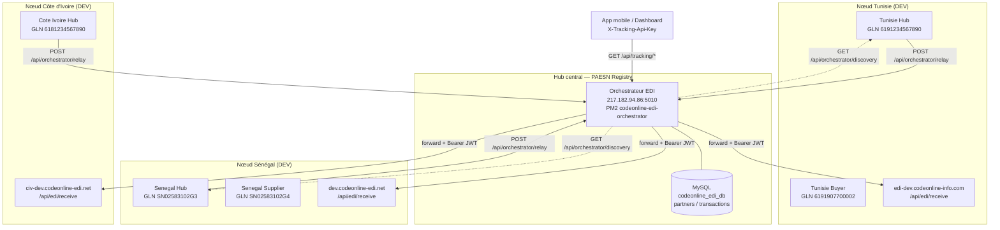
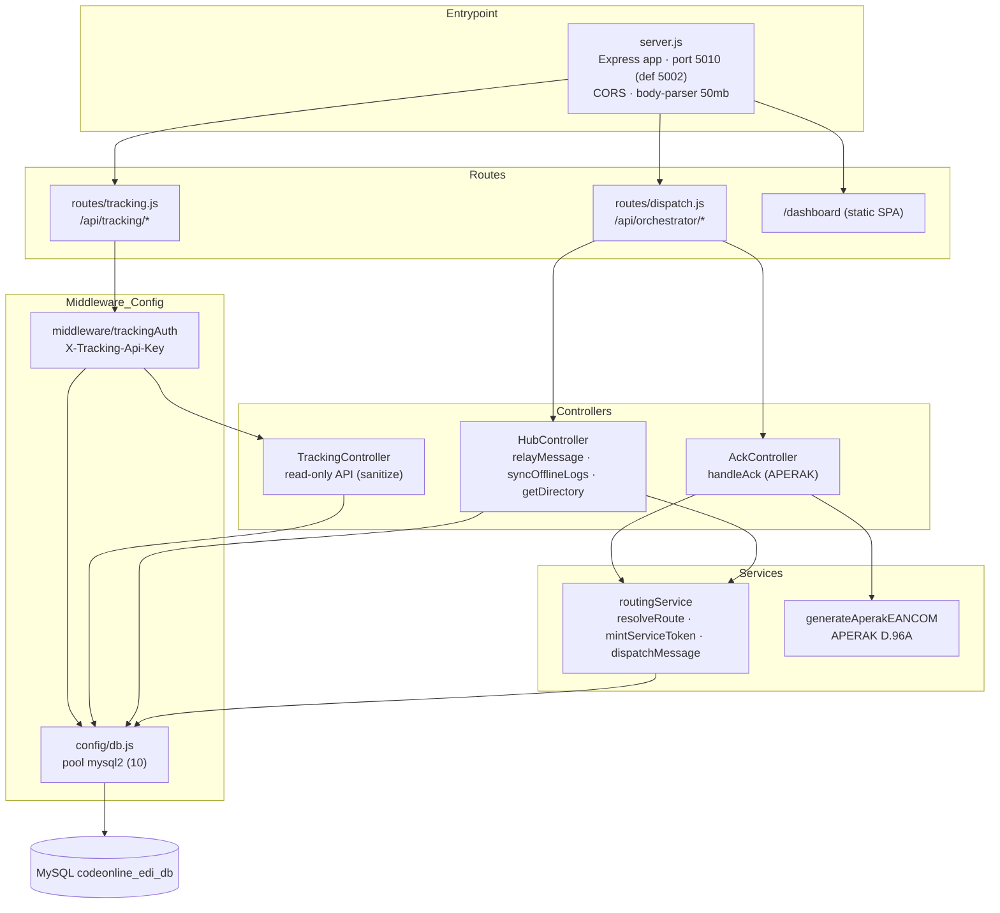
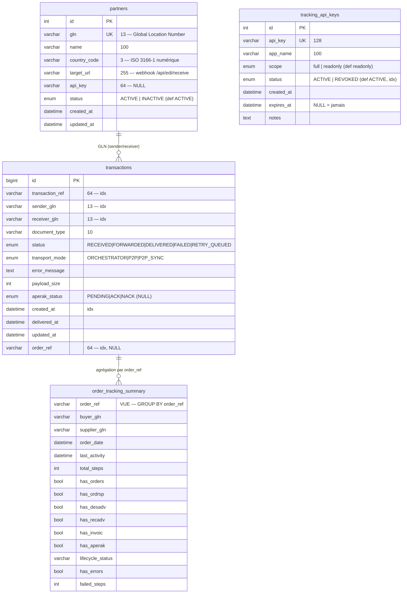
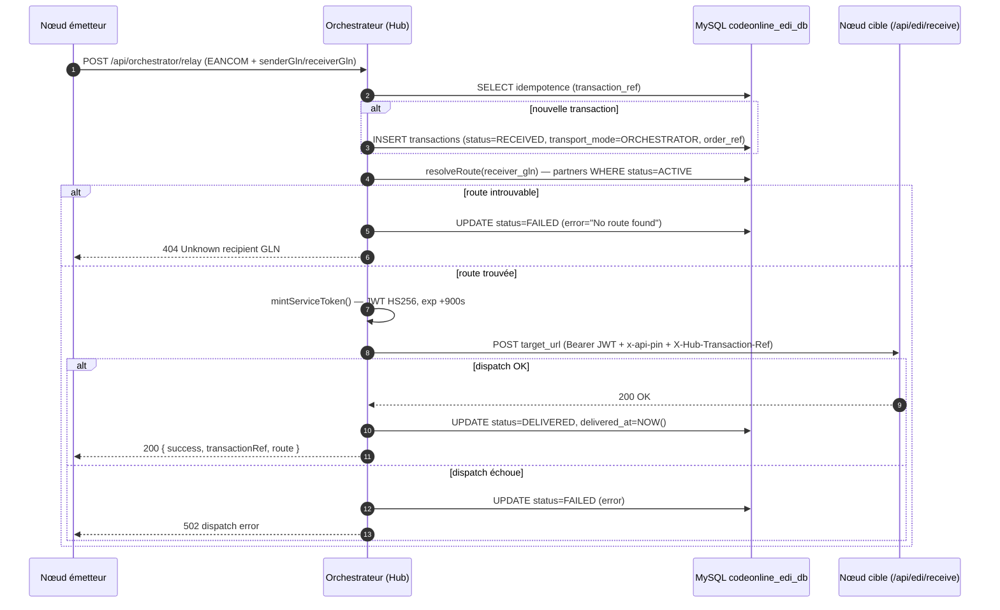

# Architecture — PAESN Registry (Orchestrateur EDI Codeonline)

> **Date :** 21 juin 2026 · **Périmètre :** environnement DEV · **Statut :** vérité terrain (vérifiée en production le jour J)

---

## 1. Résumé exécutif

Le **PAESN Registry** est l'orchestrateur central d'échange de documents EDI (EANCOM) du réseau Codeonline. Il joue **deux rôles complémentaires** :

1. **Relais / hub EDI** — il reçoit les documents commerciaux (ORDERS, ORDRSP, DESADV, RECADV, INVOIC, APERAK) émis par les nœuds pays, résout le routage à partir du GLN du destinataire, signe une identité de service, puis relaie le message vers l'URL cible du partenaire. Chaque transmission est journalisée de bout en bout (RECEIVED → DELIVERED/FAILED).
2. **Data registry central multi-pays** — la table `partners` constitue **l'annuaire de référence** : elle indexe les GLN (Global Location Numbers) de tous les partenaires des différents pays et leur point de livraison. C'est aujourd'hui un registre de routage GLN ; la vision est d'en faire l'index canonique des **GLN, puis des GTIN (codes produits) et des marques** de tous les pays du réseau.

Concrètement, l'orchestrateur expose aujourd'hui :
- un **annuaire de routage GLN** (table `partners`, source de vérité de `resolveRoute`) ;
- un **journal des échanges** (table `transactions`, 115 lignes en prod) ;
- une **API de tracking mobile** (`/api/tracking/*`, 13 endpoints, clé `X-Tracking-Api-Key`) ;
- un **dashboard admin** SPA servi statiquement.

Il tourne en Node.js + Express 4, en mode PM2 `fork`, sur le serveur `217.182.94.86` (port `5010`), avec une base MySQL `codeonline_edi_db`.

> **Point d'attention déploiement :** le serveur `217.182.94.86` (hostname `ns3254711`) héberge **simultanément** le nœud TUN DEV (PM2 `codeonline-edi-tunisie`) **et** l'orchestrateur (PM2 `codeonline-edi-orchestrator`).

---

## 2. Vision et rôle stratégique

Au-delà du simple relais de messages, le PAESN Registry a vocation à devenir le **Data Registry central du réseau Codeonline multi-pays**.

| Horizon | Périmètre du registre | État |
|---|---|---|
| **Aujourd'hui** | Index des **GLN** (Global Location Numbers) des partenaires + URL de livraison + statut | ✅ En production (`partners`, 5 lignes) |
| **Court / moyen terme** | Index des **GTIN** (codes produits, Global Trade Item Numbers) | 🎯 Cible |
| **Moyen / long terme** | Index des **marques** (brands) de tous les pays | 🎯 Cible |

La logique : un seul point d'autorité partagé par les nœuds pays (Tunisie, Sénégal, Côte d'Ivoire, et à venir d'autres) pour résoudre « qui est qui » et « où livrer ». La table `partners` est déjà la matérialisation de cette ambition pour la couche GLN. Le même socle (table de référence indexée par identifiant GS1 + API de découverte `/api/orchestrator/discovery`) se prête naturellement à l'extension vers les GTIN et les marques.

En parallèle, l'orchestrateur fournit la **traçabilité** : chaque échange est journalisé, agrégé par commande (`order_tracking_summary`) et consultable via une API de tracking et un dashboard. Le registre devient ainsi à la fois **annuaire** (qui/où) et **observatoire** (quoi/quand/statut) des flux EDI inter-pays.

---

## 3. Topologie réseau

Le réseau est constitué de **nœuds pays** (chacun héberge ses partenaires acheteurs/fournisseurs) et d'un **hub central** (l'orchestrateur PAESN Registry) qui assure le routage inter-pays et la signature de service.



**Lecture :**
- Les nœuds pays poussent leurs messages vers l'orchestrateur via `ORCHESTRATOR_URL` (`http://217.182.94.86:5010`).
- L'orchestrateur résout la cible (`target_url` du partenaire) et relaie vers `/api/edi/receive` du nœud destinataire, en y joignant un JWT de service et l'en-tête `x-api-pin`.
- Les nœuds peuvent interroger l'annuaire via `/api/orchestrator/discovery`.
- L'API de tracking et le dashboard consomment `/api/tracking/*`.

---

## 4. Stack technique

| Couche | Choix | Détail |
|---|---|---|
| Langage / runtime | **Node.js** | Mode PM2 `fork`, `max_memory_restart 500M` |
| Framework HTTP | **Express 4** (`4.18.2`) | Routeur, middlewares |
| Parsing | **body-parser** (`1.20.2`) | `limit 50mb` (gros EANCOM), `urlencoded extended:true` |
| CORS | **cors** (`2.8.5`) | Activé sans restriction (`cors()`) |
| Relais HTTP sortant | **axios** (`1.6.0`) | `timeout 30s`, `httpsAgent` `rejectUnauthorized:false` (DEV) |
| Base de données | **mysql2** (`3.6.1`) | API `mysql2/promise`, pool 10 connexions |
| Config | **dotenv** (`16.3.1`) | Secrets en `.env` (git-ignored) |
| Identifiants | **uuid** (`13.0.0`) | Génération de références |
| Signature JWT | **crypto natif** | HS256 via `createHmac('sha256', …)` |

### Pourquoi le `crypto` natif et pas `jsonwebtoken` ?

L'orchestrateur **n'a aucune dépendance `jsonwebtoken`**. Le JWT de service est forgé à la main avec le module `crypto` natif de Node.js :

- **Surface minimale** — la signature HS256 est triviale (`base64url(header).base64url(payload)` + HMAC-SHA256). Inutile d'embarquer une lib tierce et sa chaîne de dépendances pour un seul cas d'usage très simple.
- **Contrôle total du format** — payload figé `{ sub, role, instance, iat, exp }`, encodage base64url maîtrisé (`b64url` custom), TTL fixe de 900 s.
- **Compatibilité réseau** — le token reste un JWT HS256 standard, donc accepté tel quel par le `verifyJWT` standard des nœuds. Le choix crypto natif côté émetteur n'impose rien côté récepteurs.
- **Moins de dépendances = moins de risque supply-chain** et empreinte mémoire réduite (cohérent avec `max_memory_restart 500M`).

---

## 5. Architecture des composants

Le serveur s'organise en couches claires : point d'entrée (`server.js`) → routeurs → controllers → services → accès données / middleware. Le dashboard est une SPA statique.



**Rôles :**

- **`server.js`** — bootstrap Express, CORS, body-parser (50 MB), health-check racine `GET /`, montage des routeurs `/api/orchestrator` et `/api/tracking`, et serveur statique du dashboard sur `/dashboard`.
- **`routes/dispatch.js`** — 5 endpoints orchestrateur (dispatch, relay, ack, audit/sync, discovery). Pas d'authentification au niveau routeur (confiance réseau interne) ; la légitimité est portée par les JWT de service en relais.
- **`routes/tracking.js`** — 2 endpoints publics (health, document-types) puis le middleware `trackingAuth` appliqué avant les 11 endpoints protégés.
- **`HubController`** — cœur du relais EDI : idempotence, journalisation, routage, dispatch, transitions de statut, synchronisation des logs P2P offline, annuaire de découverte.
- **`AckController`** — génération et routage des APERAK (accusés ACK/NACK).
- **`TrackingController`** — API read-only de tracking (transactions, stats, partners, alerts, orders), avec assainissement systématique des messages d'erreur (`sanitizeError`) et format de sortie sécurisé (`formatTx`, ne jamais exposer le contenu EANCOM/crypto).
- **`routingService`** — résolution de route (`resolveRoute`), signature du JWT de service (`mintServiceToken`), relais HTTP sortant (`dispatchMessage`).
- **`generateAperakEANCOM`** — fabrication d'un message APERAK EANCOM D.96A conforme GS1 (orchestrateur uniquement).
- **`middleware/trackingAuth`** — double validation des clés de tracking (clé maître `.env` ou clé `ACTIVE` en base) avec cache mémoire 60 s.
- **`config/db.js`** — pool MySQL `mysql2/promise` (10 connexions), paramétré exclusivement par variables d'environnement.
- **Dashboard (`/dashboard`, `app.js` ~1403 lignes)** — SPA stateful consommant `/api/tracking/*`, login par clé API, 8 vues, graphiques Chart.js, export CSV, auto-refresh 30 s.

---

## 6. Modèle de données

Base **MySQL `codeonline_edi_db`** — 3 tables + 1 vue. **La table `partners` EST le registre** (annuaire de routage GLN, source de vérité de `resolveRoute`).



### 6.1 `partners` — TABLE registre / routage **(LE REGISTRE)**

Annuaire de référence des partenaires EDI par pays. Source unique de vérité pour `resolveRoute()` (match exact GLN).

| Colonne | Type | Clé / contrainte | Sémantique |
|---|---|---|---|
| `id` | INT AUTO_INCREMENT | **PK** | Identifiant interne |
| `gln` | VARCHAR(13) | **UNIQUE** (`idx_gln`), NOT NULL | Global Location Number |
| `name` | VARCHAR(100) | NOT NULL | Nom du partenaire |
| `country_code` | VARCHAR(3) | NOT NULL | ISO 3166-1 numérique (788/686/384) |
| `target_url` | VARCHAR(255) | NOT NULL | Webhook de réception EDI |
| `api_key` | VARCHAR(64) | NULL | Clé optionnelle d'auth vers ce partenaire |
| `status` | ENUM('ACTIVE','INACTIVE') | DEFAULT 'ACTIVE' | Filtre de routage |
| `created_at` | DATETIME | DEFAULT CURRENT_TIMESTAMP | |
| `updated_at` | DATETIME | ON UPDATE CURRENT_TIMESTAMP | |

### 6.2 `transactions` — TABLE journal (audit)

Journal exhaustif de tous les échanges EDI relayés. Une ligne par transmission. **115 lignes en prod.**

| Colonne | Type | Clé / contrainte | Sémantique |
|---|---|---|---|
| `id` | BIGINT AUTO_INCREMENT | **PK** | |
| `transaction_ref` | VARCHAR(64) | idx (`idx_ref`) | Référence de transmission |
| `sender_gln` | VARCHAR(13) | idx (`idx_sender`) | GLN émetteur |
| `receiver_gln` | VARCHAR(13) | idx (`idx_receiver`) | GLN destinataire |
| `document_type` | VARCHAR(10) | | ORDERS, ORDRSP, DESADV, RECADV, INVOIC, APERAK, UNKNOWN |
| `status` | ENUM | DEFAULT 'RECEIVED' | RECEIVED, FORWARDED, DELIVERED, FAILED, RETRY_QUEUED |
| `transport_mode` | ENUM | DEFAULT 'ORCHESTRATOR' | ORCHESTRATOR, P2P, P2P_SYNC |
| `error_message` | TEXT | NULL | Trace d'erreur (assainie avant exposition) |
| `payload_size` | INT | NULL | Taille payload (octets) |
| `aperak_status` | ENUM('PENDING','ACK','NACK') | NULL | Résultat ACK/NACK du nœud récepteur |
| `created_at` | DATETIME | idx (`idx_created_at`) | |
| `delivered_at` | DATETIME | NULL | Horodatage de livraison |
| `updated_at` | DATETIME | ON UPDATE CURRENT_TIMESTAMP | |
| `order_ref` | VARCHAR(64) | idx (`idx_order_ref`), NULL | Référence métier de commande |

Index utilitaires supplémentaires : `idx_tracking_lookup (sender_gln, receiver_gln, created_at)` et `idx_tracking_status_date (status, created_at)`.

### 6.3 `tracking_api_keys` — TABLE sécurité

Clés API par-application pour authentifier les appels `/api/tracking/*`. **1 ligne en prod.** Fallback : clé maître `TRACKING_API_KEY` (env).

| Colonne | Type | Clé / contrainte | Sémantique |
|---|---|---|---|
| `id` | INT AUTO_INCREMENT | **PK** | |
| `api_key` | VARCHAR(128) | **UNIQUE** (`idx_api_key`) | Clé brute |
| `app_name` | VARCHAR(100) | NOT NULL | Application cliente |
| `scope` | ENUM('full','readonly') | DEFAULT 'readonly' | Portée |
| `status` | ENUM('ACTIVE','REVOKED') | DEFAULT 'ACTIVE', idx (`idx_status`) | Révocation |
| `created_at` | DATETIME | DEFAULT CURRENT_TIMESTAMP | |
| `expires_at` | DATETIME | NULL | NULL = jamais |
| `notes` | TEXT | NULL | |

### 6.4 `order_tracking_summary` — VUE d'agrégation

Vue (GROUP BY `order_ref`, filtre implicite `WHERE order_ref IS NOT NULL`) qui synthétise le cycle de vie d'une commande. **19 lignes en prod.** Utilisée par `listOrders` (avec fallback requête brute si la vue est absente).

| Colonne | Calcul | Sémantique |
|---|---|---|
| `order_ref` | clé d'agrégation | Référence métier de commande |
| `buyer_gln` | `MIN(sender_gln)` | Acheteur |
| `supplier_gln` | `MAX(CASE doc=ORDRSP/DESADV/INVOIC THEN sender_gln)` | Fournisseur |
| `order_date` | `MIN(created_at)` | Date de commande |
| `last_activity` | `MAX(created_at)` | Dernière activité |
| `total_steps` | `COUNT(*)` | Nombre d'étapes |
| `has_orders … has_aperak` | `MAX(document_type=…)=1` | Présence de chaque étape |
| `lifecycle_status` | CASE | COMPLETED / INVOICED / RECEIVED / SHIPPED / CONFIRMED / ORDERED / ERROR / IN_PROGRESS |
| `has_errors` | `MAX(status='FAILED')=1` | Présence d'erreur |
| `failed_steps` | `SUM(status='FAILED')` | Nombre d'étapes échouées |

---

## 7. Surface d'API

### 7.1 `/api/orchestrator/*` — relais inter-nœuds

> Aucune authentification au niveau du routeur (confiance réseau interne). La légitimité du relais sortant est portée par le JWT de service signé par le hub.

| Méthode | Chemin | Auth | But |
|---|---|---|---|
| POST | `/api/orchestrator/dispatch` | aucune (JWT de service en relais) | Relais principal EDI — reçoit l'EANCOM, route vers le partenaire cible |
| POST | `/api/orchestrator/relay` | aucune (JWT de service en relais) | Alias de `dispatch` (même handler `HubController.relayMessage`) |
| POST | `/api/orchestrator/ack` | aucune (confiance nœud émetteur) | Reçoit ACK/NACK d'un nœud → génère APERAK et le route au fournisseur |
| POST | `/api/orchestrator/audit/sync` | aucune | Synchronisation des logs P2P offline (`transport_mode=P2P_SYNC`) |
| GET | `/api/orchestrator/discovery` | aucune (public) | Annuaire des partenaires `ACTIVE` pour découverte inter-nœud |

> Note : les controllers exposent aussi des chemins historiques `/api/dispatch`, `/api/audit/sync`, `/api/discovery` (mêmes handlers, compatibilité).

### 7.2 `/api/tracking/*` — API de tracking mobile / dashboard

> Tous protégés par le middleware `trackingAuth` (en-tête `X-Tracking-Api-Key` ou query `api_key`), **sauf** `health` et `document-types` qui sont publics.

| Méthode | Chemin | Auth | But |
|---|---|---|---|
| GET | `/api/tracking/health` | publique | Health-check (db, uptime, compteurs tx, partenaires actifs) |
| GET | `/api/tracking/document-types` | publique | Référence statique des types EANCOM |
| GET | `/api/tracking/transactions` | `X-Tracking-Api-Key` | Liste filtrée (gln, sender_gln, receiver_gln, document_type, status, from, to, page, limit) |
| GET | `/api/tracking/transactions/:ref` | `X-Tracking-Api-Key` | Détail d'une transaction par référence |
| GET | `/api/tracking/transactions/:ref/history` | `X-Tracking-Api-Key` | Timeline de statut (reconstruite) + APERAK liées |
| GET | `/api/tracking/stats` | `X-Tracking-Api-Key` | Stats globales (by_status, by_type, top_senders, avg_delivery_s, 24h, delivery_rate_pct, recent_failures) |
| GET | `/api/tracking/partners` | `X-Tracking-Api-Key` | Annuaire + agrégat de transmission (total/delivered/failed/taux) |
| GET | `/api/tracking/partners/:gln/timeline` | `X-Tracking-Api-Key` | Timeline chronologique (SENT/RECEIVED) d'un GLN |
| GET | `/api/tracking/alerts` | `X-Tracking-Api-Key` | Alertes : FAILED (7 j) + STUCK (RECEIVED/FORWARDED > 5 min) |
| GET | `/api/tracking/orders` | `X-Tracking-Api-Key` | Liste des commandes tracées + lifecycle_status (fallback vue) |
| GET | `/api/tracking/orders/:orderRef` | `X-Tracking-Api-Key` | Détail complet du cycle de vie (6 étapes) + transactions liées |

Le routeur racine fournit aussi : `GET /` (health-check JSON) et `GET /dashboard` (SPA statique) — sans authentification.

---

## 8. Logique de routage GLN

La résolution de route est centralisée dans `routingService.resolveRoute(gln)`. Elle procède en trois temps :

1. **Match EXACT** du GLN dans `partners WHERE status='ACTIVE'` → `target_url` (source `DATABASE`). C'est le cas nominal : le registre fait foi.
2. **Fallback par PRÉFIXE** si le GLN est absent de la base : `SN…` → Sénégal, `619…` → Tunisie, `618…` → Côte d'Ivoire (source `PREFIX_RULE`). Filet de sécurité pour les GLN non encore enregistrés.
3. **Sinon `null`** → destinataire inconnu (le relais répond 404 et marque la transaction FAILED).

```javascript
async function resolveRoute(gln) {
  // 1. Match exact en base (le registre fait foi)
  const [rows] = await db.execute(
    'SELECT target_url, country_code, name FROM partners WHERE gln = ? AND status = "ACTIVE"',
    [gln]
  );
  if (rows.length > 0) {
    return { url: rows[0].target_url, country: rows[0].country_code,
             name: rows[0].name, source: 'DATABASE' };
  }
  // 2. Fallback par préfixe
  if (gln.startsWith('SN')) {
    return { url: 'https://dev.codeonline-edi.net/api/edi/receive',
             country: '686', name: 'Senegal Gateway', source: 'PREFIX_RULE' };
  } else if (gln.startsWith('619')) {
    return { url: 'https://edi-dev.codeonline-info.com/api/edi/receive',
             country: '788', name: 'Tunisia Gateway', source: 'PREFIX_RULE' };
  } else if (gln.startsWith('618')) {
    return { url: 'https://civ-dev.codeonline-edi.net/api/edi/receive',
             country: '384', name: 'Cote Ivoire Gateway', source: 'PREFIX_RULE' };
  }
  // 3. Inconnu
  return null;
}
```

> **Smart routing :** lorsque le payload est détecté comme chiffré (présence de `header`/`envelope` P2P sécurisé), `HubController.relayMessage` détourne la livraison vers `/api/p2p/receive` au lieu de `/api/edi/receive`.

---

## 9. Cycle de vie d'un message

Le relais nominal d'un message via l'orchestrateur suit la séquence ci-dessous. Le hub journalise systématiquement la transaction (`RECEIVED` puis `DELIVERED` ou `FAILED`) et signe une identité de service à chaque relais sortant.



### Statuts (`transactions.status`)

| Statut | Signification |
|---|---|
| `RECEIVED` | Message reçu par le hub, transaction créée (défaut) |
| `FORWARDED` | Quittance de routage (étape intermédiaire) |
| `DELIVERED` | Livré au destinataire (ACK reçu / dispatch OK) |
| `FAILED` | Échec (route inconnue → 404, ou erreur de dispatch → 502) |
| `RETRY_QUEUED` | En attente de relance |

### Modes de transport (`transactions.transport_mode`)

| Mode | Signification |
|---|---|
| `ORCHESTRATOR` | Relais via le hub (cas nominal) — **défaut** |
| `P2P` | Échange pair-à-pair direct |
| `P2P_SYNC` | Log P2P offline synchronisé a posteriori via `/api/orchestrator/audit/sync` |

---

## 10. Sécurité

### Mécanismes en place

- **JWT de service HS256** — à chaque relais, le hub forge un token via `mintServiceToken()` (`crypto` natif) : payload `{ sub:'system', role:'service', instance:'hub', iat, exp:+900s }`, signé avec `JWT_SECRET`. Ajouté en `Authorization: Bearer <token>`, accepté par le `verifyJWT` standard des nœuds.
- **Secret partagé réseau** — `JWT_SECRET` est **identique sur tous les nœuds d'un même environnement** (et **distinct entre DEV et PROD**).
- **En-tête legacy `x-api-pin`** — `API_PIN` transmis en parallèle à chaque relais.
- **Clé de tracking double-vérif** — `trackingAuth` valide soit la clé maître `TRACKING_API_KEY` (env, scope `full`), soit une clé `ACTIVE` de la table `tracking_api_keys` (cache mémoire 60 s). 401 si clé manquante, 403 si invalide/révoquée. Vérifié : `/api/tracking/partners` renvoie 401 sans clé, 200 avec clé.
- **Assainissement des erreurs** — `sanitizeError()` masque les termes cryptographiques (`aes`, `rsa`, `encrypt`, blocs PEM, base64 longs → `[CRYPTO]`/`[PEM_REDACTED]`/`[B64_REDACTED]`) avant toute exposition publique ; `formatTx()` n'expose **jamais** le contenu EANCOM, `envelope` ni `header`.
- **Secrets externalisés** — uniquement dans `.env` (git-ignored) : `DB_HOST`, `DB_USER`, `DB_PASSWORD`, `DB_NAME`, `PORT`, `API_PIN`, `JWT_SECRET`, `TRACKING_API_KEY`. Aucun secret hardcodé, jamais poussé par le déploiement.

### Limites connues et pistes de durcissement

| Limite actuelle | Piste de durcissement |
|---|---|
| Endpoints `/api/orchestrator/*` sans auth (confiance réseau) | Valider le claim `instance:'hub'` côté nœuds ; restreindre par IP (allowlist des nœuds) |
| Pas de TLS dédié sur l'orchestrateur (`http://217.182.94.86:5010`) | Terminaison TLS / reverse-proxy ; **mTLS** entre hub et nœuds |
| `httpsAgent` `rejectUnauthorized:false` (DEV) | Réactiver la validation de certificat en PROD |
| CORS ouvert (`cors()` sans options) | Restreindre les origines autorisées |
| Pas de rate-limiting détecté | Ajouter un rate-limiter sur `/api/tracking/*` et `/api/orchestrator/*` |
| Canal P2P chiffré non finalisé | Généraliser le canal **P2P chiffré** (`/api/p2p/receive`) |
| Clé API stockée en clair dans le `localStorage` du dashboard | Passage à un schéma de session / token court terme |

---

## 11. Génération EANCOM / APERAK

L'orchestrateur est **la seule entité** responsable de la génération et du routage des **APERAK** (accusés de réception). Les nœuds buyer/supplier ne génèrent jamais d'APERAK directement : ils postent un ACK/NACK au hub via `POST /api/orchestrator/ack`, et le hub fabrique l'APERAK conforme.

**Flux `AckController.handleAck` :**
1. Validation stricte des entrées (`original_ref`, `sender_gln`, `receiver_gln`, `status ∈ {ACK, NACK}` ; `error_code` obligatoire si NACK).
2. `generateAperakEANCOM(...)` produit le message APERAK **EANCOM D.96A** (BGM function code `313` pour ACK, `314` pour NACK).
3. `resolveRoute(receiver_gln)` localise le fournisseur destinataire.
4. `dispatchMessage(route.url, payload, headers)` envoie l'APERAK (Bearer JWT + `x-api-pin`).
5. `_logAckEvent` met à jour la transaction d'origine (`LIKE %originalRef%`), puis `INSERT` d'une nouvelle ligne `document_type=APERAK, status=DELIVERED, transport_mode=ORCHESTRATOR`.

**Structure du message APERAK** (segments générés, joints par apostrophe `'`, échappement GS1 via `escapeEancom`) :

```
UNB+UNOB:1+<senderGln>:14+<receiverGln>:14+<YYYYMMDD>:<HHMM>+<icr>'
UNH+<msgRef>+APERAK:D:96A:UN:EAN008'
BGM+<313|314>+<msgRef>'
DTM+137:<YYYYMMDD>:102'
RFF+ACE:<originalRef>'
DOC+131:<originalMsgType>'
NAD+MS+<senderGln>::9'
NAD+MR+<receiverGln>::9'
ERC+<errorCode>'           (NACK uniquement)
FTX+AAO+++<errorText>'      (NACK uniquement, si fourni)
UNT+<segmentCount+1>+<msgRef>'
UNZ+1+<icr>'
```

Segments : UNB (interchange header), UNH (message header), BGM (function code), DTM (date), RFF (référence à l'original), DOC (type référencé), NAD MS/MR (émetteur/récepteur), ERC + FTX (erreurs NACK), UNT/UNZ (trailers).

---

## 12. Observabilité

Trois surfaces d'observabilité complémentaires :

- **Dashboard admin** (SPA `/dashboard`, ~1403 lignes) — login par clé `X-Tracking-Api-Key`, 8 vues : overview (stat-cards + Chart.js doughnut/bar), transactions (filtres + pagination 25/page + export CSV), tracking avancé (par ref/GLN), orders (cycle de vie 6 étapes avec progression %), partners (cards + timeline), alerts, document-types, API explorer. Auto-refresh 30 s, thème clair/sombre.
- **API de tracking mobile** — 13 endpoints `/api/tracking/*` (cf. §7.2), read-only, sécurisés et assainis.
- **Vue `order_tracking_summary`** — agrégation par commande pour le suivi de cycle de vie (ORDERED → CONFIRMED → SHIPPED → RECEIVED → INVOICED → COMPLETED).

### Métriques réelles (115 transactions en prod)

**Par statut :**

| Statut | Nombre |
|---|---|
| DELIVERED | 72 |
| FAILED | 43 |
| **Total** | **115** |

> Taux de livraison ≈ **62,6 %** (72 / 115).

**Par type de document :**

| Type | Nombre |
|---|---|
| ORDRSP | 32 |
| UNKNOWN | 30 |
| ORDERS | 23 |
| INVOIC | 19 |
| DESADV | 9 |
| RECADV | 1 |
| APERAK | 1 |

**Par mode de transport :**

| Mode | Nombre |
|---|---|
| ORCHESTRATOR | 101 |
| P2P_SYNC | 14 |

> Lecture : la part élevée de `FAILED` (43) et de `UNKNOWN` (30) sur l'environnement DEV reflète l'activité de mise au point ; ces compteurs sont surveillés via `/api/tracking/alerts` (FAILED < 7 j + STUCK > 5 min).

---

## 13. Déploiement

Modèle **immutable-secrets** : le code est déployé par `rsync`, mais le `.env` n'est **jamais** poussé. Deux profils strictement isolés DEV / PROD.

### Configuration PM2 (`ecosystem.config.cjs`)

- Défauts : nom `codeonline-edi-orchestrator`, port `5010`, logs `./logs`.
- Surchargeables via `ORCH_PM2_NAME` / `ORCH_PORT` / `ORCH_LOG_DIR`.
- Mode `fork` (1 instance), `max_memory_restart 500M`, logs fusionnés (`merge_logs:true`).
- Secrets (`DB_*`, `JWT_SECRET`, `API_PIN`, `TRACKING_API_KEY`) chargés via dotenv — **jamais** dans `ecosystem.config.cjs`.

### Script `deploy/deploy_orchestrator.sh <dev|prod>`

| Étape | Action |
|---|---|
| 0 | Validation des 9 variables obligatoires de la conf (`ENV_NAME`, `REMOTE_HOST`, `REMOTE_PORT`, `REMOTE_USER`, `REMOTE_DIR`, `LOG_DIR`, `PM2_APP_NAME`, `PM2_PORT`, `DB_NAME`) |
| 1 | **Pré-flight fatal** : si `.env` distant absent → déploiement avorté (+ instructions `scp`) |
| 2 | `rsync -az --delete` du code (exclut `node_modules/`, `.env`, `.env.bak*`, `*.bak.*`, `deploy/`, `logs/`, `.git/`) |
| 3 | `npm install` + `ORCH_* … pm2 startOrReload ecosystem.config.cjs --update-env` |
| 4 | Health-check interne `http://localhost:${PM2_PORT}/api/tracking/health` + externe `${PUBLIC_URL}/api/tracking/health` |
| 5 | Fin |

### Profils

| Paramètre | DEV (`orchestrator.dev.conf`) | PROD (`orchestrator.prod.conf`) |
|---|---|---|
| `REMOTE_HOST` | `217.182.94.86` | `__A_RENSEIGNER__` |
| `REMOTE_DIR` | `/var/www/Edi-dev/edi_orchestrator` | `/var/www/Edi-prod/edi_orchestrator` |
| `LOG_DIR` | `/var/www/Edi-dev/logs` | `/var/www/Edi-prod/logs` |
| `PM2_APP_NAME` | `codeonline-edi-orchestrator` | `codeonline-edi-orchestrator-prod` |
| `PM2_PORT` | `5010` | `5012` |
| `DB_NAME` | `codeonline_edi_db` | `codeonline_edi_db_prod` (**isolée**) |
| `PUBLIC_URL` | `http://217.182.94.86:5010` | `__A_RENSEIGNER__` |
| `JWT_SECRET` | — | **DISTINCT** de DEV |

**Principes :** secrets jamais poussés (pré-flight `.env` obligatoire) · base PROD totalement isolée (`codeonline_edi_db_prod`) · `JWT_SECRET` PROD distinct de DEV · health-check interne + externe après chaque reload.

---

## 14. Stratégie de stockage et montée en charge (relationnel vs NoSQL)

### 14.1 Choix retenu : rester en relationnel (MySQL)

Le PAESN Registry **reste sur MySQL** comme source de vérité. NoSQL n'est **pas** justifié par la charge ni par la forme des données.

**Charge cible (estimation).** Plusieurs milliers de requêtes/jour, ≥ 10 serveurs pays, plusieurs applications, centaines d'utilisateurs via les API de recherche et de tracking.

| Volume/jour | Moyenne | Pic réaliste | Capacité MySQL (1 serveur) |
|---|---|---|---|
| 100 000 req | ~1,2 req/s | ~10–50 req/s | **milliers de req/s** |

→ La charge sollicite ~1–2 % de la capacité d'un MySQL indexé. **Le volume n'est pas un argument pour NoSQL** (pertinent plutôt à des millions de req/s, des téra de données ou du multi-région).

**Forme des données.** Tout est relationnel + accès par lookups indexés et agrégations :

| Usage | Requête | Adéquation relationnel |
|---|---|---|
| `registry_fp` par GTIN | match exact sur index | ✅ |
| `registry_fp` par marque / catégorie | filtre + pagination | ✅ |
| Tracking transactions | par ref / partenaire / commande + stats | ✅ (jointures + vue `order_tracking_summary`) |
| `partners` | annuaire (petite table) | ✅ |

Passer en document store (MongoDB) ferait **perdre** : JOINs, transactions ACID, la vue d'agrégation, les `GROUP BY` et la familiarité de l'équipe — pour **aucun gain** à cette charge.

### 14.2 Les vrais leviers de performance (à activer quand mesuré, pas par anticipation)

1. **Cache Redis** devant les lectures search/tracking. Les lookups GTIN/marque sont très répétés et cachables → la majorité des hits ne touchent plus la base. **C'est l'accélérateur principal**, pas un changement de moteur.
2. **Moteur de recherche** (Meilisearch / Typesense / OpenSearch) **uniquement pour `product_index`** si l'on veut tolérance aux fautes, ranking, recherche multilingue (fr/ar/en) et facettes. Il **complète** MySQL (qui reste la source de vérité), il ne le remplace pas.
3. **Hygiène SQL** : index adaptés (`gtin`, `brand`, clés transactions), pool de connexions `mysql2` dimensionné, pagination systématique, archivage/partitionnement des anciennes `transactions` à terme.

### 14.3 Architecture de stockage recommandée

```
Source de vérité : MySQL (codeonline_edi_db)
   └─ partners · transactions · tracking_api_keys · product_index
+ Redis           (cache des lectures search/tracking)      ← quand la charge le justifie
+ Meilisearch/Typesense (recherche produit avancée, UX)     ← optionnel, si recherche floue/multilingue
```

### 14.4 Quand reconsidérer NoSQL (déclencheurs futurs)

- Catalogue produits à **attributs très hétérogènes par pays** (schéma qui explose) → store document pour `product_index` en **hybride** (relations en MySQL, fiches en document).
- **Dizaines de millions** de produits/requêtes ou déploiement **géo-distribué multi-région**.
- Flux d'**événements massifs** append-only → store time-series dédié.

Aucun de ces seuils n'est atteint aujourd'hui : optimiser pour eux maintenant serait de la sur-ingénierie. Le goulot d'étranglement viendra des **requêtes N+1 / index manquants / pool de connexions**, jamais du choix MySQL-vs-NoSQL à ce volume.

---

## 15. Roadmap / évolutions

| Axe | Objectif |
|---|---|
| **Data Registry étendu** | Étendre la table de référence des **GLN** aux **GTIN** (produits) et aux **marques**, faisant du PAESN Registry l'index canonique GS1 multi-pays |
| **Mise en PROD** | Renseigner `REMOTE_HOST`/`PUBLIC_URL` PROD, provisionner `codeonline_edi_db_prod`, `JWT_SECRET` distinct, premier déploiement `deploy_orchestrator.sh prod` |
| **Durcissement sécurité** | TLS dédié + **mTLS** hub↔nœuds, validation du claim `instance:'hub'`, allowlist IP, CORS restreint, rate-limiting |
| **Canal P2P chiffré** | Généraliser le routage `/api/p2p/receive` et le chiffrement de bout en bout |
| **Fiabilité** | Exploiter `RETRY_QUEUED` (relances automatiques), réduire le taux de `FAILED`/`UNKNOWN` |
| **Découverte** | Enrichir `/api/orchestrator/discovery` pour la synchronisation automatique de l'annuaire entre nœuds |

---

## 16. Annexes

### A. Plan des GLN (registre `partners` réel)

| GLN | Nom | Pays (ISO 3166 num.) | URL cible | Statut |
|---|---|---|---|---|
| `6191234567890` | Tunisie Hub | Tunisie (788) | `https://edi-dev.codeonline-info.com/api/edi/receive` | ACTIVE |
| `6191907700002` | Tunisie Buyer | Tunisie (788) | `https://edi-dev.codeonline-info.com/api/edi/receive` | ACTIVE |
| `SN02583102G3` | Senegal Hub | Sénégal (686) | `https://dev.codeonline-edi.net/api/edi/receive` | ACTIVE |
| `SN02583102G4` | Senegal Supplier | Sénégal (686) | `https://dev.codeonline-edi.net/api/edi/receive` | ACTIVE |
| `6181234567890` | Cote Ivoire Hub | Côte d'Ivoire (384) | `https://civ-dev.codeonline-edi.net/api/edi/receive` | ACTIVE |

Correspondance des préfixes de fallback : `SN` → Sénégal (686) · `619` → Tunisie (788) · `618` → Côte d'Ivoire (384).

### B. Variables d'environnement (`.env`, git-ignored)

| Variable | Usage | Remarques |
|---|---|---|
| `DB_HOST` | Hôte MySQL | |
| `DB_USER` | Utilisateur MySQL | |
| `DB_PASSWORD` | Mot de passe MySQL | |
| `DB_NAME` | Base | `codeonline_edi_db` (DEV) / `codeonline_edi_db_prod` (PROD, isolée) |
| `PORT` | Port d'écoute | `5010` (DEV) / `5012` (PROD) ; défaut code `5002` |
| `JWT_SECRET` | Secret HS256 du JWT de service | **Partagé** entre nœuds d'un même env, **distinct** DEV/PROD |
| `API_PIN` | En-tête legacy `x-api-pin` | Transmis aux nœuds à chaque relais |
| `TRACKING_API_KEY` | Clé maître API mobile de tracking | Scope `full` |

### C. Référence — endpoints de découverte et health

| Endpoint | Auth | Usage |
|---|---|---|
| `GET /` | aucune | Health-check racine (service, status, port, endpoints) |
| `GET /api/tracking/health` | aucune | Health-check détaillé (db, uptime, compteurs, partenaires actifs) — utilisé par le déploiement |
| `GET /api/orchestrator/discovery` | aucune | Annuaire des partenaires `ACTIVE` (découverte inter-nœud) |
