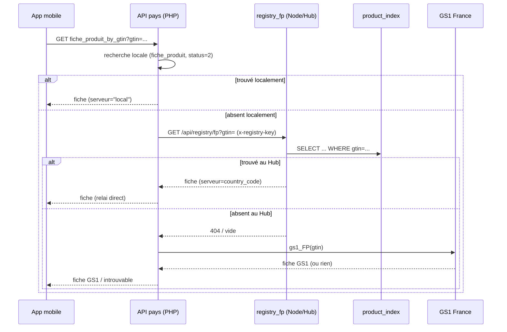

# Diagnostic & proposition — Fallback produits cross-pays via le service `registry_fp` (PAESN Registry)

**Date :** 21 juin 2026
**Périmètre :** API produits mobile (CodeIgniter, `codeonline-fp`) + Hub orchestrateur (PAESN Registry, Node)
**Objectif :** Quand l'app mobile cherche un produit (par GTIN, par marque) sur un serveur pays (ex. CIV) et ne le trouve **pas localement**, basculer vers le **Hub** (index central des produits/marques de tous les pays).
**Principe directeur :** Le fallback est déclenché depuis le PHP par **un simple appel HTTP** à un nouveau service Node (`registry_fp`). **Aucune logique métier ajoutée en PHP.** Isolation totale entre les APIs → le code PHP pourra être **remplacé intégralement par du Node.js** plus tard, sans couplage.

---

## 1. Diagnostic de l'existant

### 1.1 Composants & emplacements (serveur CIV)

| Élément | Détail |
|---|---|
| App API produits | `/var/www/codeonline-fp` — **CodeIgniter 3** (PHP), distincte de l'app EDI Node |
| Contrôleur API | `application/controllers/api_fp/V1_fp.php` (REST_Controller, méthodes `*_get`) |
| Modèle SQL | `application/models/api_fp/Api_model_fp.php` |
| Base de données | **`Entitedb`** (localhost, groupe `dbEntite`) — différente du `Dev_Entitedb` de l'EDI |
| Table produits | **`fiche_produit`** + jointures `Entite`, `pays`, `brickgpc` |
| Hub (PAESN) | `217.182.94.86:5010`, Node/Express, DB `codeonline_edi_db` |

### 1.2 Fonctionnement actuel de l'API

**Recherche par GTIN** — `fiche_produit_by_gtin_get()` :
1. `fiche_produit_gtin()` exécute :
   ```sql
   SELECT fiche_produit.images, brand, subBrand, libelle AS productName,
          short_libelle AS shortName, gtin, pays.libelle AS countryOfOrigin,
          brickgpc.libelleBrique..., prix_min AS prixMin, prix_max AS prixMax,
          code_cader AS codeCader, Entite.raison_socialle AS companyName,
          Entite.gln, Entite.adresse, Entite.telephone, Entite.email, Entite.site
   FROM fiche_produit
   JOIN Entite   ON Entite.id_entite = fiche_produit.idEntreprise
   JOIN pays     ON pays.isoNumeric  = fiche_produit.countryOfOrigin
   JOIN brickgpc ON brickgpc.codeBrique = fiche_produit.codebrique
   WHERE fiche_produit.gtin LIKE <gtin> AND fiche_produit.status = 2;
   ```
2. **Si trouvé** → renvoie la fiche, taggée `serveur = "local"`.
3. **Si vide** → appelle `gs1_FP($gtin)` = fallback vers l'**API GS1 France** (`api.gs1.fr`).

**Recherche par marque** :
- `fiche_produit_name_brand($brand)` → liste de marques (`LIKE brand`).
- `fiche_produit_marque_categorie_by_brand_get` → marques + catégories.
- `fiche_produit_by_brand_category_get` → produits paginés par marque + catégorie.

**Forme de réponse attendue par le mobile (shape) :**
`images[]`, `brand`, `subBrand`, `productName`, `shortName`, `gtin`, `countryOfOrigin`, `libelleBrique`, `prixMin`, `prixMax`, `codeCader` / `codeCaderAr`, `companyName`, `gln`, `adresse`, `telephone`, `email`, `site`, `netContent`, `serveur`.

### 1.3 Constat clé : un point de fallback existe déjà

Le contrôleur applique **déjà** le motif exact souhaité (et tague la source) :

```php
if (!empty($response)) {
    // ... mise en forme ...
    $response['serveur'] = "local";
    $this->response($response, REST_Controller::HTTP_OK);
} else {
    $this->gs1_FP($this->get('gtin'));   // fallback externe existant
}
```

→ Brancher le Hub = **insérer un appel** entre « local vide » et `gs1_FP`. Le champ `serveur` permet déjà de distinguer la source.

### 1.4 État du Hub aujourd'hui

DB `codeonline_edi_db` = uniquement `partners`, `transactions`, `tracking_api_keys`, `order_tracking_summary`.

> ❌ **Aucune table produit/marque, aucun index cross-pays, aucun endpoint de recherche produit.** Le Hub possède sa base, mais l'**index produit reste à créer et à alimenter**. C'est le seul vrai chantier.

### 1.5 Verdict de faisabilité

| Côté | Difficulté | Justification |
|---|---|---|
| **API mobile (PHP)** | 🟢 Très faible | Motif de fallback déjà présent ; un seul appel HTTP à ajouter ; **zéro logique** |
| **Service Node `registry_fp`** | 🟡 Modéré | Table d'index + endpoints (triviaux) + **ingestion** des produits pays → Hub (le vrai travail) |

**Conclusion : faisable proprement.** Le PHP reste minimal et jetable ; l'intelligence est en Node.

---

## 2. Principe architectural retenu

1. **Isolation stricte** : le PHP ne connaît du Hub qu'**une URL et une clé**. Aucune requête SQL cross-base, aucun partage de code.
2. **PHP = proxy mince** : on ajoute **une seule méthode** `registry_fp()` au contrôleur, qui fait un `curl` vers le service Node — exactement comme `gs1_FP()`. Pas de modèle, pas de SQL, pas de règle métier.
3. **Toute la logique en Node** (`registry_fp`) : recherche dans l'index cross-pays, dédup multi-pays, mise en forme à la shape mobile, et — à terme — la recherche locale elle-même.
4. **Migration future PHP → Node** : comme le contrat est purement HTTP, on pourra remplacer `V1_fp.php` par un service Node sans toucher au mobile ni au Hub. Le `registry_fp` PHP disparaît, le mobile pointe directement vers le service Node.

---

## 3. Architecture cible

```mermaid
graph LR
    subgraph Mobile
      APP[App mobile]
    end
    subgraph "Serveur pays (CIV) — codeonline-fp (PHP, CI3)"
      PHP[V1_fp.php<br/>recherche locale]
      PROXY[registry_fp&#40;&#41;<br/>proxy mince HTTP]
      LDB[(Entitedb<br/>fiche_produit)]
      PHP --> LDB
      PHP -. miss .-> PROXY
    end
    subgraph "Hub PAESN Registry (Node, 5010)"
      RFP[Service registry_fp<br/>/api/registry/fp/*]
      PIDX[(product_index<br/>cross-pays)]
      RFP --> PIDX
    end
    GS1[API GS1 France]

    APP -->|HTTP| PHP
    PROXY -->|HTTP + clé| RFP
    PHP -. dernier recours .-> GS1
```



**Chaîne de résolution (GTIN)** : recherche **locale** → si vide, **`registry_fp` (Hub)** → si vide, **GS1**.

---

## 4. Côté Node — nouveau service `registry_fp` (dans le Hub PAESN)

> Exposé comme une **surface d'API indépendante** (`/api/registry/fp/*`) afin de pouvoir, plus tard, l'extraire en microservice dédié ou y rapatrier la recherche locale.

### 4.1 Table d'index `product_index` (denormalisée = shape mobile, zéro jointure à la lecture)

```sql
CREATE TABLE product_index (
  id            BIGINT PRIMARY KEY AUTO_INCREMENT,
  country_code  VARCHAR(3)  NOT NULL,      -- 788 TUN / 686 SEN / 384 CIV
  source_gln    VARCHAR(13) NOT NULL,      -- GLN entreprise détentrice
  gtin          VARCHAR(14) NOT NULL,
  brand         VARCHAR(150),
  sub_brand     VARCHAR(150),
  product_name  VARCHAR(255),
  short_name    VARCHAR(255),
  images        TEXT,                       -- liste séparée par ';' (idem fiche_produit)
  country_origin VARCHAR(3),
  brick_code    VARCHAR(20),
  brick_fr      VARCHAR(255),
  brick_ar      VARCHAR(255),
  brick_en      VARCHAR(255),
  prix_min      DECIMAL(12,2),
  prix_max      DECIMAL(12,2),
  code_cader    VARCHAR(20),
  company_name  VARCHAR(255),
  adresse       VARCHAR(255),
  telephone     VARCHAR(50),
  email         VARCHAR(150),
  site          VARCHAR(150),
  status        TINYINT DEFAULT 2,
  updated_at    DATETIME DEFAULT CURRENT_TIMESTAMP ON UPDATE CURRENT_TIMESTAMP,
  UNIQUE KEY uniq_country_gtin (country_code, gtin),  -- même GTIN possible dans plusieurs pays
  KEY idx_gtin (gtin),
  KEY idx_brand (brand),
  KEY idx_brand_brick (brand, brick_code)
);
```

### 4.2 Endpoints du service

| Méthode | Chemin | Rôle | Auth |
|---|---|---|---|
| GET | `/api/registry/fp?gtin=` | Fiche produit cross-pays par GTIN (le « registry_fp ») | clé service |
| GET | `/api/registry/fp/brands?brand=` | Marques cross-pays (LIKE) | clé service |
| GET | `/api/registry/fp/products?brand=&categoryCode=&page=` | Produits par marque + catégorie, paginés | clé service |
| POST | `/api/registry/fp/sync` | Upsert batch (ingestion depuis un pays) | clé service |

La réponse `GET /api/registry/fp?gtin=` renvoie **directement la shape mobile** (mêmes clés que la fiche locale, `serveur = country_code`), pour que le PHP la relaie sans transformation.

### 4.3 Authentification (interne, jamais exposée au mobile)

- Header dédié `x-registry-key`, **ou** réutilisation du **JWT de service HS256** déjà en place sur le Hub.
- Le **mobile ne parle jamais au Hub** : seul le serveur pays (ou, demain, le service Node de remplacement) appelle `registry_fp` avec la clé interne.

### 4.4 Ingestion — alimentation de l'index (le vrai chantier)

| Option | Principe | Recommandation |
|---|---|---|
| **1. Push pays → Hub (cron)** | Chaque pays pousse les deltas `fiche_produit` (status=2, `updated_at > dernier_sync`) vers `POST /api/registry/fp/sync` | ✅ **Recommandé** — chaque pays reste maître de ses données, robuste, index toujours à jour |
| 2. Pull Hub → pays | Le Hub lit chaque base pays / appelle un endpoint d'export | Couplage cross-serveur, plus fragile |
| 3. Live federated | Le Hub interroge l'API pays en direct à chaque miss | Pas d'index réel, latence, dépend de tous les pays en ligne |

**Reco : Option 1**, upsert idempotent sur `(country_code, gtin)`, cron horaire ou quotidien par pays.

---

## 5. Côté PHP — modification minimale (`V1_fp.php`)

> **Une seule méthode ajoutée + une seule insertion.** Aucune logique métier, aucun accès base. Conçu pour être **supprimé** le jour de la bascule full‑Node.

### 5.1 La méthode proxy `registry_fp()`

```php
/**
 * Proxy mince vers le service Node registry_fp (Hub PAESN).
 * Aucune logique métier ici : on relaie la requête et la réponse.
 */
private function registry_fp($gtin) {
    $url = HUB_REGISTRY_URL . '/api/registry/fp?gtin=' . urlencode($gtin);
    $ch  = curl_init($url);
    curl_setopt_array($ch, [
        CURLOPT_RETURNTRANSFER => true,
        CURLOPT_TIMEOUT        => 4,                       // court : ne bloque pas le mobile
        CURLOPT_HTTPHEADER     => ['x-registry-key: ' . HUB_REGISTRY_KEY],
    ]);
    $out  = curl_exec($ch);
    $code = curl_getinfo($ch, CURLINFO_HTTP_CODE);
    curl_close($ch);
    if ($out === false || $code != 200) return null;
    return json_decode($out, true);                        // déjà à la shape mobile
}
```

### 5.2 L'insertion dans `fiche_produit_by_gtin_get()`

```php
// ... if (!empty($response)) { ... serveur="local" ... return ... }
else {
    $hub = $this->registry_fp($this->get('gtin'));        // fallback Hub
    if (!empty($hub)) {
        $this->response($hub, REST_Controller::HTTP_OK);  // serveur = country_code (renseigné par le Node)
    } else {
        $this->gs1_FP($this->get('gtin'));                // dernier recours : GS1 (inchangé)
    }
}
```

### 5.3 Configuration PHP

Dans `application/config` : `HUB_REGISTRY_URL` (ex. `http://217.182.94.86:5010`) et `HUB_REGISTRY_KEY` (clé interne). Rien d'autre.

> La recherche par marque suivra le même motif en phase 2 (méthodes `registry_fp_brands()` / `registry_fp_products()`, toujours de simples proxys).

---

## 6. Cycle de vie d'une requête (GTIN)



---

## 7. Sécurité

- **Mobile → API pays** : authentification existante, inchangée.
- **API pays → `registry_fp`** : header `x-registry-key` (ou JWT de service). Communication interne uniquement.
- **Hub jamais exposé au mobile.** Le service `registry_fp` n'est appelé que par les serveurs pays de confiance.
- `POST /api/registry/fp/sync` : protégé, **idempotent** (upsert), vérifie le `country_code` de l'émetteur.

---

## 8. Phasage

| Phase | Contenu | Effort indicatif |
|---|---|---|
| **MVP** | Table `product_index` + `GET /api/registry/fp` (GTIN) + ingestion CIV + méthode `registry_fp()` + insertion dans V1_fp | ~0,5–1 j |
| **P2** | Ingestion TUN + SEN + fallback marque / catégorie (proxys supplémentaires) | ~1 j |
| **P3** | Cron deltas automatique, dédup multi-pays, dashboard Hub (stats index) | ~1 j |

> Tout est d'abord monté sur l'environnement **DEV** (Hub 5010 + CIV) puis validé avant PROD.

---

## 9. Migration future PHP → Node (rendue triviale par l'isolation)

Parce que le contrat est purement HTTP :
1. **Aujourd'hui** : `V1_fp.php` fait la recherche locale + délègue le fallback à `registry_fp` (Node).
2. **Étape suivante** : on rapatrie aussi la **recherche locale** dans le service Node (`registry_fp` interroge la base pays). Le PHP devient un proxy quasi vide.
3. **Bascule** : le mobile pointe directement vers le service Node ; `V1_fp.php` et son proxy `registry_fp()` sont **supprimés**. Aucun changement côté Hub.

Aucune étape ne casse le mobile : le **contrat de réponse (shape) reste constant**.

---

## 10. Décisions à trancher avant implémentation

1. **Ingestion** : push pays → Hub (recommandé) ou pull ?
2. **GTIN multi-pays** : si le produit existe dans plusieurs pays, on renvoie quoi ? (premier trouvé / priorité au pays appelant / liste) 
3. **Détail produit** : le Hub renvoie la fiche complète denormalisée (recommandé, simple) ou un pointeur que le mobile re-résout côté pays ?
4. **Fraîcheur** : synchronisation à la création/maj d'une fiche, ou batch cron périodique ?
5. **Clé interne** : header `x-registry-key` dédié ou réutilisation du JWT de service existant ?
6. **DEV d'abord** : valider sur Hub DEV (5010) + CIV, puis PROD ?

---

## 11. Annexes

### 11.1 Shape de réponse `registry_fp` (identique à la fiche locale)

```json
{
  "images": ["url1", "url2"],
  "brand": "…", "subBrand": "…",
  "productName": "…", "shortName": "…",
  "gtin": "…", "countryOfOrigin": "…",
  "libelleBrique": "…",
  "prixMin": 0, "prixMax": 0,
  "codeCader": "…", "codeCaderAr": "…",
  "companyName": "…", "gln": "…",
  "adresse": "…", "telephone": "…", "email": "…", "site": "…",
  "netContent": "", "unitCodeNetContent": "",
  "serveur": "384"
}
```

### 11.2 Variables de configuration

| Côté | Variable | Exemple |
|---|---|---|
| PHP (`config`) | `HUB_REGISTRY_URL` | `http://217.182.94.86:5010` |
| PHP (`config`) | `HUB_REGISTRY_KEY` | (clé interne) |
| Node (`.env`) | clé d'auth registry / JWT_SECRET | (secret) |
| Node (`.env`) | accès DB `codeonline_edi_db` | (existant) |
